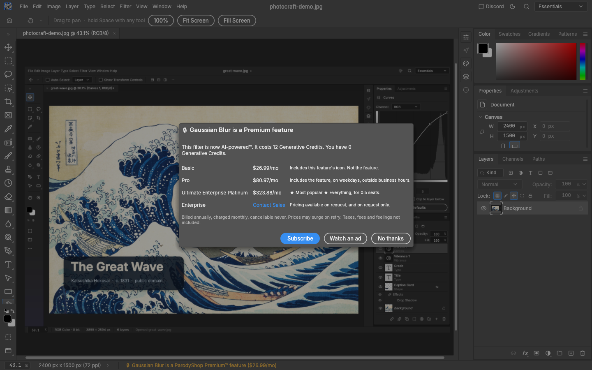
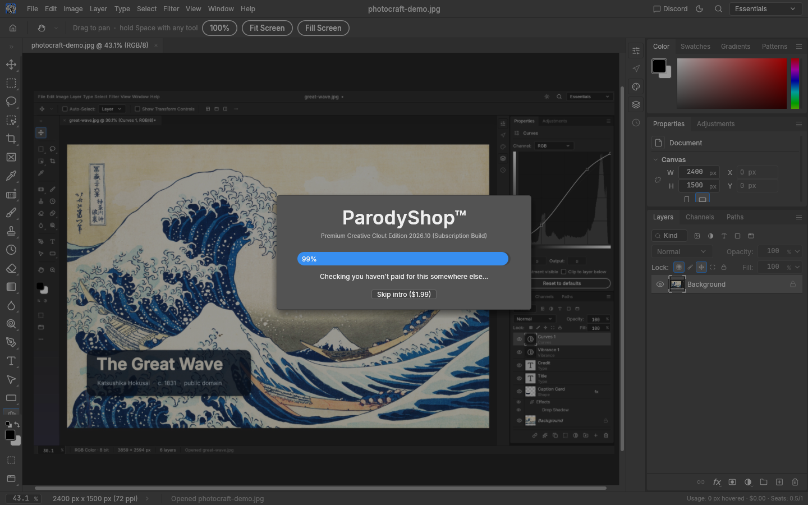
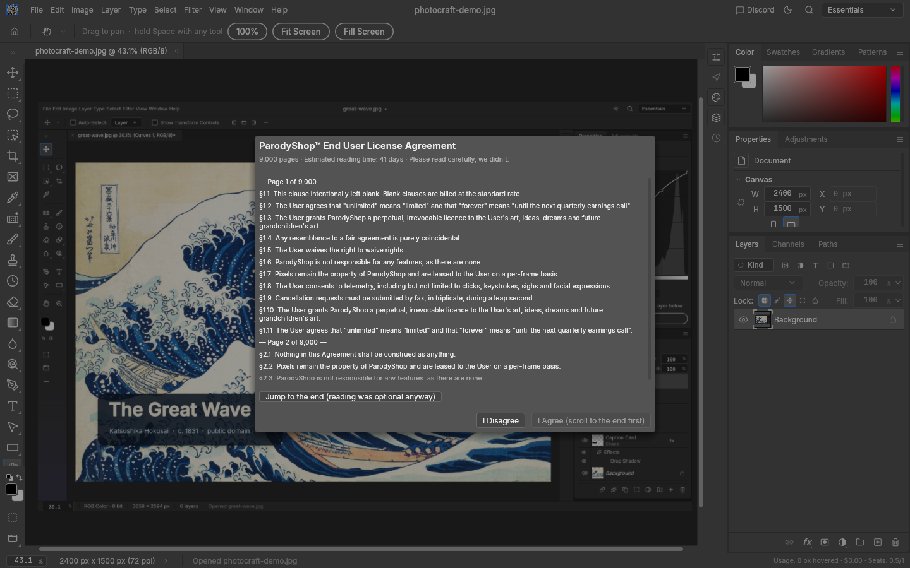
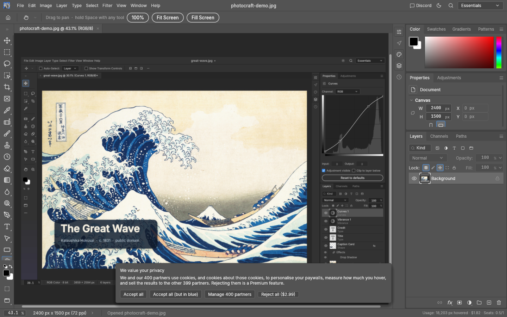
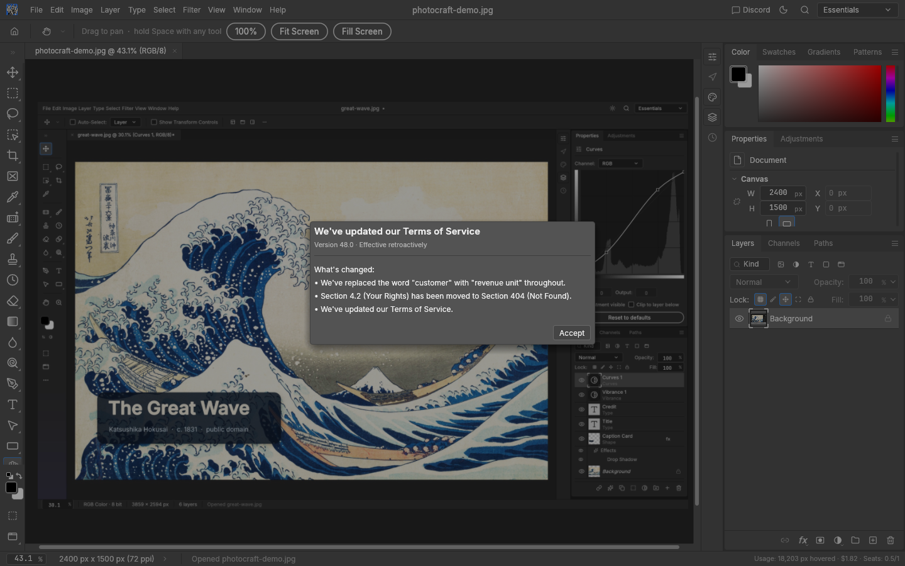
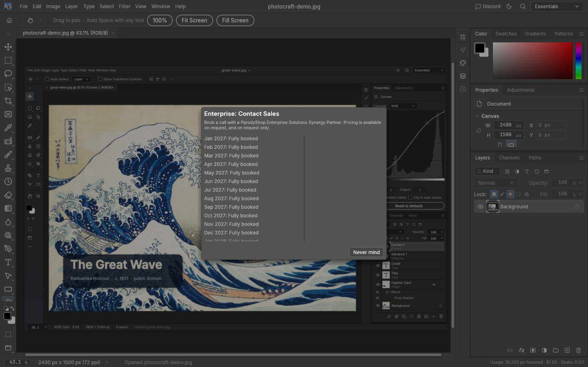

<h1 align="center">ParodyShop™</h1>

<p align="center">
  <b>The open-source image editor where every feature is a Premium™ feature.</b><br>
  100% Rust. 100% open source. 0% of features included in your plan.
</p>

<p align="center">
  
  
  
  
  
  
</p>

<p align="center">
  
  <br>
  <sub>Trying to use Gaussian Blur. The free trial lets you look at a screenshot of the features you don't have.</sub>
</p>

> [!WARNING]
> **This is a parody.** ParodyShop is a joke fork of [PhotoCraft](https://github.com/storytold/photocraft), an open-source
> image editor written in Rust. It is not affiliated with, endorsed by or sponsored by Adobe, the PhotoCraft maintainers,
> or anyone with a pricing page. **It never asks for payment details and never takes money.** Every "payment" is declined.

## What is this?

You know how image editors used to be software you bought, and then became software you rent, and then became software
that rents *you*? ParodyShop finishes the journey.

Underneath, it's a complete native image editor: layers, masks, adjustment layers, filters, type, vectors, brushes and
real PSD files. On top, every single one of those features is behind a subscription offer you cannot complete.

## Features™

| Feature | Free tier | Premium |
|---|---|---|
| Hand tool | ✅ So you can wave goodbye to your money | ✅ |
| Zoom tool | ✅ So you can get a closer look at what you're missing | ✅ |
| Every other tool | ❌ | ❌ Payment declined |
| Every menu item | ❌ | ❌ Payment declined |
| Undo | ❌ Regret is a luxury good ($999.99/mo) | ❌ |
| Redo | ❌ Billed per undo of the undo ($1,499.99/mo) | ❌ |
| File › Exit | ❌ Requires ParodyShop Exit+ | ❌ The window's close button is still free. For now. |
| Fonts | ❌ Licensed per letter. Vowels cost extra. | ❌ |
| Filters | ❌ Now AI-powered™: 12 Generative Credits each. You have 0. | ❌ |
| Help | ❌ Enterprise support contract required (response time: 6–8 business years) | ❌ |

### Everything in the box (sold separately)

Every tool from PhotoCraft is here, fully working, and individually leased by the hour:

<h4>🧰 67 tools</h4>
Move · Artboard · Rectangular and Elliptical Marquee · Single Row Marquee · Single Column Marquee · Lasso · Polygonal Lasso · Magnetic Lasso · Object Selection · Quick Selection · Magic Wand · Crop · Perspective Crop · Slice · Slice Select · Frame · Eyedropper · Color Sampler · Ruler · Note · Count · Remove · Spot Healing Brush · Healing Brush · Patch · Content-Aware Move · Red Eye · Brush · Pencil · Mixer Brush · Color Replacement · Clone Stamp · Pattern Stamp · History Brush · Eraser · Background Eraser · Magic Eraser · Gradient · Paint Bucket · Blur · Sharpen · Smudge · Dodge · Burn · Sponge · Pen · Freeform Pen · Curvature Pen · Add Anchor Point · Delete Anchor Point · Convert Point · Horizontal and Vertical Type · Horizontal and Vertical Type Mask · Path Selection · Direct Selection · Rectangle · Ellipse · Triangle · Polygon · Line · Custom Shape · Hand · Rotate View · Zoom

Two of them (Hand and Zoom) are on the free tier. The other 65 are tastefully displayed behind glass.

### The subscription experience

- **Three plans for every feature.** *Basic* includes the feature's icon, not the feature. *Pro* includes the feature on
  weekdays, outside business hours. *Ultimate Enterprise Platinum* is the most popular, because we say so.
- **Surge pricing.** Each time you try a feature again, it costs 15% more. Persistence is a premium trait.
- **Payment processing.** "Contacting Creative Clout™…", "Checking your credit score…", "Selling your browsing history to
  cover the transaction fee…". Then: *"Card declined: ParodyShop does not accept real money."*
- **Watch an ad to unlock.** A five-second ad for ParodyShop Premium™ (now with even more paywalls, in 4K!). Your ad
  revenue of $0.0003 is credited to your account. Remaining balance: still a lot.
- **A "No thanks" button that argues back.** *"Real artists pay. Are you sure you want to keep your money?"* Declining a
  subscription you don't have incurs an early termination fee of $84.99, payable never.
- **Loyalty status.** Collect declined payments to reach Platinum Declinee status.
- **Engagement-based pricing.** Prices go up 1% for every minute you spend in the app. The more you use it, the more
  it's worth to you.
- **Enterprise: Contact Sales.** No price, just a calendar that's fully booked until a single 3:00 AM slot in March 2031.
  They will reschedule.
- **Every price ends in .99**, as is the law.

### The full software-as-a-service experience

The paywall is just the beginning. ParodyShop ships with everything you love about modern subscription software:

| | |
|---|---|
|  | **A splash screen that phones home.** "Verifying license…", "Phoning home again (nobody answered)…", "Downloading 4 GB of mandatory updates to the updater…". The progress bar rushes to 99% and stays there. Skipping the intro costs $1.99. |
|  | **A 9,000-page EULA** (estimated reading time: 41 days). *I Agree* stays greyed out until you scroll to the end. Clauses include *"ParodyShop may change the price at any time, including during this sentence"* and *"The User waives the right to waive rights."* Disagreeing is a Premium feature. |
|  | **A cookie banner with 400 partners.** *Accept all*, *Accept all (but in blue)*, *Manage 400 partners* or *Reject all ($2.99)*. Rejecting cookies goes through the paywall. |
|  | **Manage your partners.** All 400 of them (Data Brokers Ltd, Blockchain Harvest Inc., Funnel Vibes LLC…) have a *legitimate interest* in you, and legitimate interests can't be switched off. Your choices are saved and ignored. |
|  | **"We've updated our Terms of Service."** Two minutes in, then every ten minutes after that. Effective retroactively. Accept is the only button, and Esc doesn't work. One of the changes is always *"We've updated our Terms of Service."* |
|  | **Enterprise sales.** Pricing available on request, and on request only. Book a call with a ParodyShop Enterprise Solutions Synergy Partner. Fully booked, month after month, until the slot in 2031. |

And, quietly running the whole time:

- **Usage-based billing.** The status bar meters every pixel your pointer hovers over, at $0.0001 each:
  `Usage: 18,203 px hovered · $1.82 · Seats: 0.5/1`. Hover less to save money.
- **Half a seat.** You're using ParodyShop as 0.5 users. Upgrade to a whole user with ParodyShop Premium™.
- **"Your plan is changing."** A notice every few minutes: *"We're raising prices so that we can keep prices low."*,
  *"Premium is now Premium Classic. The new Premium costs more and includes less."* No action is required. No action is
  possible.

### Built for agents (who also have to pay)

PhotoCraft lets AI agents drive every feature over a JSON control channel and an MCP server. ParodyShop keeps that, and
replies to every request with the HTTP status code that was invented for exactly this and never used:

```json
{"ok": false, "error": "402 Payment Required: `filter.blur.gaussianBlur` (Gaussian Blur) is a ParodyShop Premium™ feature. Agent seats are $26.99/mo per token. Tip: ask your human for their credit card. (Don't.)"}
```

## Pricing

| Plan | Price | What you get |
|---|---|---|
| Free | $0.00 | The Hand tool, the Zoom tool, and this README |
| Basic | $4.99–$63.99/mo per feature | The feature's icon |
| Pro | 3× Basic | The feature, on weekdays, outside business hours |
| Ultimate Enterprise Platinum | 12× Basic | Everything, for 0.5 seats |
| Open Source | Free, forever | See below |

Billed annually, charged monthly, cancellable never. Prices may surge on retry. Taxes, fees and feelings not included.

## How to unlock everything

It's open source. Read the source.

```sh
PARODYSHOP_OPEN_SOURCE=1 cargo run --release -p photocraft
```

With `PARODYSHOP_OPEN_SOURCE=1`, the paywall is off and you get the full PhotoCraft editor underneath. Which is the
entire point of open source, and the punchline of this project.

(The web build has no environment variables, so in the browser you're stuck paying. Forever.)

## Get started

You need [Rust](https://rustup.rs) 1.95 or newer.

```sh
git clone https://github.com/VariableDeclared/photocraft parodyshop
cd parodyshop
cargo run --release -p photocraft        # the full ParodyShop™ experience
```

On Linux you'll also need the usual windowing and GPU development packages (see `docs/development.md`).

### Where the paywall lives

Everything in PhotoCraft is a command, so one function puts all of it behind the paywall:

- `crates/ui-egui/src/paywall.rs`: the offer, the plans, surge pricing, the fake payment flow, the ad, and the jokes.
- `crates/ui-egui/src/menus.rs`: `menus::invoke` asks the paywall first, which covers every menu item, shortcut,
  command palette entry and panel button.
- `crates/ui-egui/src/lib.rs`: once per frame, `paywall::guard_tool` hands back any tool you haven't paid for.
- `crates/ui-egui/src/control.rs`: agents get `402 Payment Required`.
- `crates/ui-egui/src/saas.rs`: the splash, EULA, cookie banner and partners, Terms updates, plan-change notices,
  usage meter, seats, engagement-based pricing and the sales calendar.

`Services::paywall` turns it on. It's off by default, so PhotoCraft's own test suite still tests the real features
(the paywall itself has tests too, in `paywall.rs`).

To regenerate the screenshots:

```sh
cargo build --release -p photocraft-ui-egui --example snapshot
snap() { ./target/release/examples/snapshot --size 1440x900 --scale 1 --open docs/images/photocraft-demo.jpg "$@"; }
snap --out docs/images/parodyshop-paywall.png --paywall filter.blur.gaussianBlur
for s in splash eula cookies partners terms sales; do snap --out docs/images/parodyshop-$s.png --saas $s; done
```

## Contributing

Pull requests require an active ParodyShop Contributor Seat ($19.99/mo, billed per line of code). Issues will be
triaged by our Premium Support team within 6–8 business years.

Just kidding. PRs with new jokes are welcome: see [CONTRIBUTING.md](CONTRIBUTING.md).

## Credits and license

ParodyShop is a fork of [PhotoCraft](https://github.com/storytold/photocraft) by the
[ArtCraft](https://getartcraft.com/) community, an excellent, genuinely free, open-source image editor written in Rust.
Every feature you can't use here, you can use there. Go give them a star.

Licensed, like PhotoCraft, under either of [MIT](LICENSE-MIT) or [Apache-2.0](LICENSE-APACHE) at your option. Third-party
assets and their licenses are listed in [ATTRIBUTION.md](ATTRIBUTION.md) and [NOTICE](NOTICE). The ArtCraft logos are not
open source and aren't used here.

The license, unlike everything else, is free.
