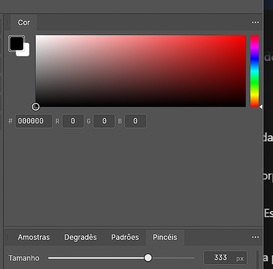
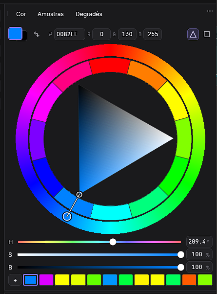

# Color panel for illustration

The Color tab now defaults to an sRGB hue wheel with an inner saturation/value triangle.
By default the pure-hue corner follows the ring marker; a contrasting pointer connects them.
With rotation disabled, pure hue is on the right, white at the upper left and black at the lower left.
Drag the ring to change hue, or the triangle to mix the selected hue with white and black.
The gesture stays with the control where it started, even if the pointer crosses another area.

- **Triangle / Square** icon buttons switch between the circular selector and the rectangular selector.
- Click the foreground or background swatch to select which brush colour to edit. Double-click
  opens the existing full Color Picker dialog. The swap button uses the existing colour command.
- The existing panel **ellipsis menu** holds HSB visibility, recent colours, triangle rotation,
  the twelve-colour ring, and harmony mode. These options no longer occupy rows in the body.
- **HSB Sliders** shows or hides compact hue, saturation and brightness rows.
  Very short panels put H/S/B numeric controls on one line.
- HEX and RGB fields remain editable. Colour values use the same sRGB convention as brush colours.
- **Rotate Triangle** makes the pure-hue corner point at the selected hue on the ring.
  Turn it off to keep the triangle pointing right. The selected colour stays the same.
- The **Recent Colors** menu option shows or hides the history without clearing its colours.
  The selector uses the space released when history is hidden.
- **Recent Colors** remembers up to twelve distinct colours. A drag adds its final colour instead
  of every intermediate sample. Click a swatch to reuse it; **+** saves only the latest recent colour
  (accent border) to an existing or newly named Swatches group.
- The circular selector grows with the panel while preserving its shape. The layout reserves
  the header and HSB/history controls first and shrinks the selector in short panels, keeping HEX/RGB, HSB and
  recent swatches visible without scrolling the entire panel. Short, wide panels place the
  selector beside the controls; taller panels place the controls below it. The rectangular selector also
  uses the remaining height. Recent swatches use a single compact row.
- The inner twelve-colour ring has wider segments and matching hit areas for easier clicking.

Picker mode, slider/history visibility, triangle rotation, and recent colours are included in saved workspace layouts when
Remember Workspace Changes is enabled. Existing layouts without these fields keep defaults.

Automation: `ui.set {"colorPanel":{"picker":"wheel","sliders":true}}` selects the wheel;
`picker:"rectangle"` restores the rectangular selector. `background:true` edits the background. `show_recent:false` hides history and
`rotate_triangle:false` selects fixed orientation.
`ui.inspect.colorPanel` exposes the state. `ui.set` uses whole-object replacement semantics,
so omitted fields receive defaults.

This panel works with the existing upstream dock. It does not depend on bilateral panel docking
or a movable toolbar. It is an original implementation informed by artist colour-picker workflows;
it contains no MagicPicker code or artwork. HSB brightness is HSV value, not perceptual lightness.

## Optional twelve-colour inner ring

**12-Color Ring** toggles a segmented ring between the outer hue wheel and the triangle.
Click or drag its segments to select a suggested colour. The gesture uses a frozen palette
until release, so picking a suggestion does not shift its targets under the pointer.

- **Related Colors** places the selected hue at the centre of a segment and samples hues
  every 30 degrees relative to it. Tooltips identify the base, analogous neighbours, the
  opposite/complementary colour, triadic, tetradic and split-complementary relationships.
- **RGB Circle** anchors the twelve samples at red (0 degrees), independent of the selection.
  Tooltips identify additive RGB primaries (red, green, blue), secondaries and tertiaries.

Both modes preserve the selected saturation and HSV brightness. Consequently grey or black
bases produce grey or black suggestions; the outer wheel remains a full-colour hue reference.
This is an RGB harmony model, not a change to the document's storage mode. Applying a segment
sets the same sRGB brush foreground/background used by the existing Color panel; paint and
fill keep their existing document conversion paths. It does not introduce ICC soft proofing
or claim that all suggested display colours can be printed in CMYK.

Automation fields: `harmony_ring` (boolean), `harmony_mode` (`related` or `rgb`). Both are
serialized with the Color panel state. Turning the ring off restores the triangle's space.

## Responsive header

Foreground/background swatches and swap stay left; editable HEX/RGB sits centrally;
triangle and square buttons select wheel and field on the right. Below 414 points,
HEX/RGB moves to a centred second row and channel groups wrap together in narrower
docks. Both picker modes share the header swatches; the selector has no duplicate readout.

## Save the latest recent color

The history + menu saves only the latest valid history entry, highlighted with an accent border.
It previews that color and lets the user choose an existing Swatches group or name a new one.
The action uses the existing swatches.newGroup/swatches.add commands and preset persistence;
it does not save the entire history or change the active painting color. Empty history disables +.

Picker button tooltips use Triangle and Square. The square selector has a six-point
responsive inset on every side. With Rotate Triangle enabled, a contrasting pointer
connects its pure-hue vertex to the outer hue marker and updates during hue drags.

## Visual comparison

These user-supplied PhotoCraft screenshots show the original panel and the accepted result.
They use different themes, panel sizes and selected colours; this is a feature comparison,
not a matched pixel comparison. The after capture comes from the accepted Windows build
which also has independent workspace changes; this contribution contains only the Color panel.

| Before | After |
| --- | --- |
|  |  |
