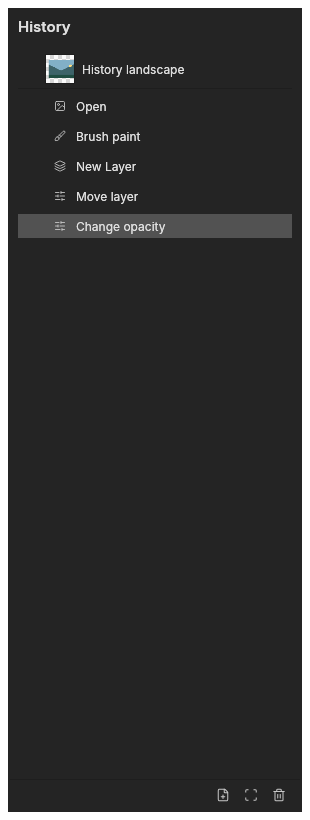
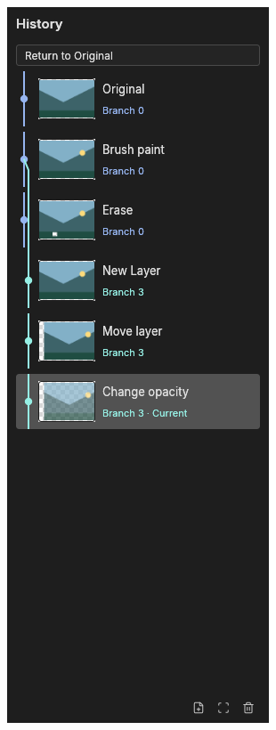

# History port and modernization roadmap

This series brings Sean's local-history feature family to upstream `main`.
The feature inventory and proposed product work are tracked in
[Modernize History into a professional branching revision workspace #5369](https://github.com/storytold/photocraft/issues/5369).
Search, bookmarks, branch naming, a larger branch overview and comparison previews
are follow-up product work, not claims about this port.

## Sources and commit boundaries

The inspected source is fork `main` at
`14c612c24b270ff62aaddd38bf64776c823f6003` (2026-10-13).
The fresh integration branch starts at upstream `main`
`369704ac551e8e409800e423ff550c353d5522ef`.
The final refresh rebases the series over upstream's native-printing integration;
its menus, dependencies and translations remain intact.

| Individual commit | Source / purpose |
|---|---|
| Shared undo cache | `47de563c`: upstream port of fork cache #1; shared RAM accounting, compressed scratch objects, fallible restore, preferences and workload CI. |
| Durable recovery | `e812d6e2`: upstream port of fork recovery #2; exact document/history checkpoints and durable completion/retry. |
| Compact moves | `a6e0117d`: upstream-compatible counterpart of fork `cc12f1d6` / #18; each raster nudge stays separately undoable. |
| Coordinate validation | `0203f6d4`: retain the supported coordinate range while validating overflow. |
| Replay identity | `49f8f41d`: reject stale compact replay across intervening/coalesced changes. |
| Branches and scrubber | `56a653e3` / fork #25: stable navigation identities, alternate paths, worker restores/thumbnails, unlimited defaults and recovery version 2. Conflict adaptation includes the history-only implementations integrated on inspected fork main. |
| Append-follow | `636ff301` / fork #26: follow only while browsing the bottom. |
| Short-dock footer | `2889675e` / fork #36: keep snapshot/history controls reachable. |
| Snapshot-name independence | `c49c323d` / fork #36: state growth drives scrolling even when a snapshot shares an action's name; virtualized snapshots coexist with states. |
| Current upstream compatibility | Reconcile native-format source/loader changes, current movement APIs, background recovery, theme tokens, snapshot controls, and index-based navigation. Retain upstream accounting oracles for masks, selections, patterns, video, coalesced states and transferred tiles. |

The first nine commits retain cherry-pick provenance. The final adaptation commit
records conflict resolution and fixes needed for current upstream. The series has
no fork-main merge and includes no runtime-theme catalog, HDR implementation,
extra export writers or collaboration networking dependency.

## Behavior and boundaries

- Managed history RAM is shared across open documents; it is not a process-memory
  cap. Unlimited action retention and available-space scratch are the defaults.
  Explicit numeric preferences preserve bounded-mode compatibility.
- Local edits after undo retain alternate paths. Direct state navigation loads
  only its destination and commits once; cancelled/failed loads leave the current
  state intact. Thumbnails use a separate bounded cache.
- Native scratch is ephemeral; complete recovery checkpoints are durable and
  restore the last successfully completed write, including branch identities.
  Normal `.pcraft` document saves remain a separate lifecycle.
- Browser history remains RAM-only. Per-artist collaboration history depends on
  the separate collaboration feature family; this series does not add networking.
- Upstream snapshot commands, layer targeting and history consumers remain
  available. The index-based `history.selectState` compatibility command uses
  the same fallible, single-destination restoration as stable-ID navigation.

See [Undo cache](undo-cache.md), [Recovery](recovery.md), and
[Control protocol](control-protocol.md) for settings and automation.
Historical benchmark figures in those documents apply to their recorded source
revisions and workloads; they are not validation of the new published head.

## Visual evidence

These images use the same original synthetic landscape. The before capture runs
upstream's panel layout against that fixture; the after captures run the complete
ported dock, including its footer. The acceptance example verifies reachable
footer controls and exact original/alternative/current restoration. Light and
Classic captures verify the existing upstream theme vocabulary.

| Upstream layout | Branching dock |
|---|---|
|  |  |

[Light theme](images/history-scrubber/upstream-after-light.png) ·
[Classic theme](images/history-scrubber/upstream-after-classic.png)

The port also preserves the successful Save As filename through command-based
Undo, Redo and direct navigation. A regression covers these routes at all three
sample depths; the imperative Undo/Redo API retains its upstream behavior.
