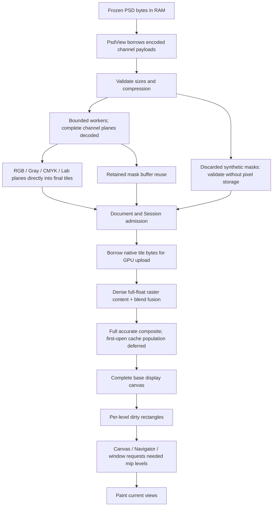

# PSD loading performance work

Tracking issue: https://github.com/storytold/photocraft/issues/5392.

Implementation proceeds sequentially on one branch. Keep each measured checkpoint so that
later parser, upload and composition changes can be compared against the immediately prior
version. Generated PSDs and images are local fixtures, not committed assets.

## Validated checkpoints

The Linux experiment uses immutable 7360×4912 three-layer and complex eight-layer PSDs
created from an original generated 1536×1024 image, scaled deterministically. The three-layer
file's BLAKE3 is `497008838e0cd18506e4b2e0cf533ff001f53fe22d1bbc1a9aab41d90df8de0b`.

Ryzen 9 7950X3D / RTX 3090, Vulkan, Rust 1.99, release opt-level 3, LTO off,
16 codegen units, `-C target-cpu=native` for both reference and candidate. The fixed-file
harness times in-memory import, Session admission, full-canvas GPU encode/submit and wait.
Disk, GPU initialization, compositor construction, readback and validation are excluded.
The compositor is fresh per sample. Alternate and reverse version order; keep raw samples.
These are P44-class workloads, not the original CI P44 file or native UI startup measurements.

Historical fork-based evidence: the prior import prototype reduced measured three-layer opening from 621 to 250 ms and
complex opening from 287 to 136 ms. That historical comparison is separate from subsequent
adjacent comparisons; do not combine batches to attribute a gain to a single change.

| Sequential step | Three-layer reference → candidate | Evidence |
|---|---:|---|
| Borrow native tile bytes during GPU upload | 251.3 → 236.0 ms | `perf/experiments/psd-open-linux-step1.json` |

The direct upload step removes temporary copies for native RGBA8/GRAY8 formats while
preserving shared-tile grouping and ordered uploads. CPU preparation changed from 87.3 to
71.1 ms in the paired three-layer run. The complex run was noisy (136.0 → 134.8 ms overall);
no precise complex speedup is claimed for this step.

## Correctness

The retained import prototype passed 35 PSD compression tests and three focused import
integration tests, including malformed channels, deterministic warning order, PSD/PSB,
8/16/32-bit samples, negative bounds, masks and multi-depth round trips. Complete imported
raster/mask/structure signatures match both fixed fixtures. Four representative GPU crops
per fixture pass the CPU oracle within one 8-bit level plus floating-point tolerance; this
is not full-frame GPU bitwise equality. The direct-upload shared-tile/multi-format unit test
also passed on Linux.

The parallel RLE path validates packets in original row order before initializing the full
output; removing that validation caused a malformed-file memory regression in a rejected
trial. Worker-count tuning and fixed packing blocks were rejected because they did not
produce repeatable useful improvements.

## Scope and remaining architecture

All retained import, upload, fusion, cache, mask, sample-format and mip changes are combined
on one branch. The architecture evaluations below distinguish assessed proposals from
implemented changes. Sparse base-canvas initialization, approximate display, lazy source
realization, row-band streaming and opaque-raster pruning remain structural follow-ups.
Navigator reuse already exists upstream. Current validation and final combined results are
recorded at the end of this document.

## Upstream checkpoint

Upstream implementation PR: https://github.com/storytold/photocraft/pull/5396, based directly
on upstream main `583425b4df1c57a4515f591fed64fcedf8440cba`. The initially opened fork
PR was closed; unrelated fork changes are excluded.

The upstream control measured 504.0→197.4 ms (three layers) and 216.3→113.3 ms (complex).
See `perf/experiments/psd-open-linux-upstream-total.json`. Borrowed parsing alone in an
adjacent comparison measured 235.2→199.4 ms, with import 119.3→83.5 ms; complex
129.9→112.4 ms. See `perf/experiments/psd-open-linux-borrowed.json`. These pooled medians
use six warm samples in opposite-order batches; phase medians need not sum exactly.

All 211 PSD unit tests and the three import-equivalence tests passed on the upstream
checkpoint. The oracle now includes a distinct parent group mask. Its density uses an exact
PSD-representable 8-bit value, preserving the strict source-versus-import comparison.
Both fixture signatures and representative GPU crops remain valid. Borrowed metadata omits
encoded buffers deliberately; decoding uses PsdView and roundtrip uses to_owned. The owned
PsdFile API and upstream depth-specific global-layer precedence are preserved.

Current upstream already has GPU Navigator reuse (#4518), including initial GPU waiting;
that item needs no duplicate implementation here. Corpus-enabled PSD/IO suites pass; see final validation below for lint, WASM and UI results.

## Raster pass fusion

Dense raster layers without clipping units now combine content/mask sampling and final
blend in one pass. Sparse layers, effects, groups and clipping keep their prior paths.
Full-float accumulation uses the fused path; half-float accumulation deliberately preserves
separate passes and their intermediate rounding without requiring optional shader features.

Adjacent Linux comparison: three-layer 198.4 → 193.0 ms; complex 113.0 → 111.4 ms.
The dense fixture changes from 7 to 4 planned passes with unchanged source uploads. See
`perf/experiments/psd-open-linux-fusion.json`. All GPU unit/integration tests pass, including
fused/unfused masks/blends/depths and half-float fallback. The submission-pressure regression
uses 1,100 layers so that the new fused plan still crosses the 1,000 operation submission limit;
CPU parity, one-chunk and forced-flush assertions are retained.

The PSD and IO packages also pass their corpus-enabled suites on the borrowed-import
checkpoint: 401 PSD and 590 IO tests, no failures.

## First-open cache admission

Fresh supported GPU canvases request a one-shot deferral of lower-stack cache population.
The default compositor behavior and cache budgets remain unchanged; subsequent renders
can populate/reuse the cache. Empty/failed preflight and discardable encode calls do not
consume the request. Stale cache entries are cleared on the deferred render.

End-to-end adjacent comparison, including import: three-layer 190.9 → 181.0 ms;
complex 109.7 → 101.4 ms. See `perf/experiments/psd-open-linux-cache-endtoend.json`.
A separate GPU-only opening-plus-two-64×64-edits experiment measured opening 142.7 → 82.2 ms,
first edit 1.60 → 2.01 ms, second edit 0.45 → 1.22 ms, total 144.8 → 85.4 ms.
That experiment uses separate conditioning and excludes import/admission; its absolute
times and savings must not be added to the end-to-end comparison. Both policies receive
excluded warmup pairs and six alternating measured pairs. See
`perf/experiments/psd-open-linux-cache-policy.json` for all samples and CPU checks.

Initial deferred cache bytes are 0 rather than 512 MiB; after the first small edit the cache
holds 16 MiB and the second edit reuses it. All GPU tests pass (98 cases), including
opening/stale-cache/discarded-encoder/partial-edit regressions across depths. Linux
`cargo check -p photocraft-ui-egui` passed at this checkpoint; subsequent offscreen UI
inspection is recorded below. Interactive native acceptance remains pending.
The full opening harness's `cache-defer` mode requires `--features deferred-cache` and
fresh compositors. Older reference builds remain compatible without that feature.

## Mask materialization

Retained single-channel masks reuse exact-length decoded buffers and convert sample byte
order in place. Packed depth-1 or unusual plane lengths retain the original interleave
fallback. Synthetic masks already discarded by existing vector/rendered-layer rules receive
complete capped channel validation without materializing decoded pixels or tiles. Real-mask
precedence, preferred vector blocks, malformed-channel warnings and absent-channel behavior
remain unchanged.

Adjacent Linux comparison with deferred caches on both sides: three-layer 181.6 → 181.5 ms
(effectively unchanged); complex 101.7 → 98.7 ms, import 45.3 → 42.1 ms. See
`perf/experiments/psd-open-linux-masks.json`. Both frozen signatures and representative GPU
crops pass. Corpus-enabled suites passed 402 PSD and 594 IO tests, including warning parity,
packed masks, decoder error parity and retained sample values at several depths.

Upstream main advanced to `369704ac551e8e409800e423ff550c353d5522ef` with printing changes
and was merged into this same branch. The measurements above isolate the mask change before
that merge; affected integration checks are recorded separately.

## Architecture evaluations

The implemented paths retain full-resolution imported pixels and a fully valid base canvas.
The remaining proposals change ownership or display readiness and need separate acceptance
criteria. They are evaluated here rather than represented as implemented optimizations.

| Proposal | Current code constraint | Decision and required follow-up |
|---|---|---|
| Sparse viewport-first composition | An unchanged document revision skips composition; Navigator samples the whole canvas. | Do not restrict the first render alone: pan would expose stale/uninitialized pixels. Add base-tile revision/coverage tracking and collect demand from every viewport, rotation, Pattern Preview and Navigator before rendering. Fit-to-screen still demands the whole document. |
| Approximate initial display | Existing measurements finish an exact full-resolution composite; saved PSD composites may be absent or stale. | Keep the default accurate. A preliminary proxy needs explicit readiness state and separate preliminary/accurate/full-completion measurements plus visual acceptance for masks, effects, adjustments and HDR. |
| Lazy hidden/offscreen raster materialization | Raster layers store realized Surfaces; the borrowed source ends at import completion. | Requires owned source backing and realization state across visibility, editing, compositors, native saves, PSD export, history and recovery. Skipping hidden records would lose data. ZIP validation still inflates the stream even if pixels are not retained. |
| Bounded decode-to-tile streaming | Full decoded planes remain allocated; predictors/checksums can fail after earlier rows. | A new row-band decoder must align color/alpha channels and publish tiles transactionally, preserving all-or-empty failed-layer behavior and deterministic warning order. This is a further memory optimization; not delivered by direct tile packing. |
| Opaque raster coverage pruning | Current occlusion predicates accept opaque fills, not raster bounds. Mutable tile bytes have no invalidated alpha/coverage summary. | Bounds do not prove opacity. Add cached, mutation-invalidated alpha/hole summaries and retain all blend/mask/effect exclusions; do not scan whole surfaces every redraw or discard layers on an unproven inference. |

These evaluations preserve original pixels, hidden/off-canvas data and current warning/error
semantics. The structural follow-ups remain open in the umbrella issue; no speedup is claimed
for an unimplemented path.

## Direct tiles at other depths and models

RGB, grayscale, CMYK and Lab alpha surfaces now assemble exact planar samples directly into
final tiles at U8/U16/F32. The specialized RGBA8 loop remains. Missing-channel fills, CMYK
inversion, Lab16 chroma scaling, endian conversion, transparent padding and byte pruning
match the prior interleave/write path. Unsupported or malformed plane layouts fall back.
Float RGB preserves HDR values, signed zero and NaN payloads without numeric conversion.

Adjacent same-file comparison: U16 595.1 → 446.0 ms (import 400.2 → 254.4 ms);
F32 1125.2 → 788.5 ms (import 882.6 → 562.2 ms). U8 three-layer 179.9 → 179.8 ms;
complex 98.4 → 100.0 ms (no useful improvement claimed for those U8 cases). Nine pixel tests
and three source/roundtrip oracles pass; frozen fixture signatures and GPU crops match.
See `perf/experiments/psd-open-linux-depth.json`.

High-depth files were generated once from the frozen three-layer image with the standalone
`depth_fixture` generator, outside timing. U16: 490531278 bytes, BLAKE3
`64dfd543cc846601f0fa527854e0cd813c2d4480987b3bd2e337418e4bcdc93e`.
F32: 500522218 bytes, BLAKE3
`7724a7d9d356e99337f2edcf80dec7d9afdf0e0bcbcacd3ec25d127dc7c25b87`.
An initial trial accidentally reused identical Cargo executables after a timestamp-preserving
source transfer; it was rejected. The retained comparison forced recompilation and verified
distinct executable hashes before running. Subsequent source transfers invalidate mtimes.

## Demand-driven display mips

Each tile now retains independent dirty rectangles for every mip level. Uploads invalidate
the whole downstream chain; callbacks generate visible tiles only through `ceil(lod)`.
Shallow regeneration leaves deeper damage pending. Later pan/zoom/Navigator/window callbacks
catch up without requiring another document edit. The base canvas and texture allocation
remain complete. Fractional trilinear sampling, odd dimensions, one-dimensional tiles,
rotated Pattern Preview offsets and the DX12 scratch path retain their original behavior.

The separate 36 MP canvas upload-plus-demand benchmark measured 18.0 → 16.7 ms at 1×,
17.6 → 17.1 ms at fit, and 17.5 → 17.0 ms with fit plus Navigator. Opening plus two small
edits measured 18.5 → 16.8, 18.0 → 17.3 and 17.9 → 17.3 ms respectively. This excludes
import, allocation and painting to the screen; do not add these values to the import/GPU
completion benchmark. `perf/experiments/psd-open-linux-mips.json` retains both variants,
all raw samples and excluded warmups in ABBA order.

Nine UI GPU/Navigator tests pass, including full-chain numerical comparisons, independent
damage at different levels, disjoint edits, fractional LOD, rotated/offset callbacks and
panning at unchanged revision. Strict UI lint and all WASM checks pass. An offscreen GPU UI
capture of the complex PSD was inspected: the image, masks, hidden layer and group stack
render correctly. That capture is visual evidence, not release timing or interactive user
acceptance.

## Final combined upstream run

Reference: upstream main `369704ac551e8e409800e423ff550c353d5522ef`. Candidate: retained
code at `e55b4388` (subsequent documentation and benchmark lock updates do not change the
production code). Both standalone harnesses use identical dependency locks, compiler flags,
adapter and immutable files. Executable hashes differ and are retained with the Linux logs.

| Frozen workload | Upstream reference | Combined candidate | Reduction |
|---|---:|---:|---:|
| 36 MP, three-layer U8 | 487.2 ms | 179.9 ms | 63.1% |
| Complex eight-layer U8 | 229.9 ms | 98.7 ms | 57.1% |
| Three-layer U16 | 924.2 ms | 435.3 ms | 52.9% |
| Three-layer F32 | 1440.6 ms | 784.5 ms | 45.5% |

Six warm samples per variant in opposite-order batches, with excluded cold runs. Reference
uses its original eager cache policy; candidate uses the retained one-shot first-open deferral.
The endpoint remains in-memory import, Session admission and full-canvas GPU completion.
Disk, GPU setup, readback, screen painting and native application startup are excluded.
The separately measured mip optimization is not part of these values and is not added to them.

`perf/experiments/psd-open-linux-final.json` stores phase medians/raw samples;
`psd-open-linux-final-validation.json` stores both variants' GPU reports, cold runs,
representative errors and complete import signatures. All four files' complete imported
raster/mask/structure/warning signatures match, including 16/32-bit variants. Representative
GPU crops match the CPU oracle within the documented tolerance; this is not full-frame GPU
bitwise equality or an exact replay of the original CI P44 file.

Final checks: 1001 corpus-enabled PSD/IO tests, 98 GPU tests, all 2687 UI unit tests
and 109 UI integration tests across 26 targets passed. Nine targeted GPU/Navigator cases
are included in the UI suite. Strict Clippy for PSD/IO/GPU/UI across all targets, dependency layering and all WASM
checks passed. The complex PSD was opened and visually inspected in the Linux offscreen
GPU UI; interactive native acceptance remains for a maintainer/user.

Formatting checks, the repository quick performance run and generated scorecard check also
pass. The broad integration run exposed an existing Camera Raw GPU-initialization failure:
the complete target failed identically on unmodified upstream main, while its isolated case
passed. Its test fixtures now share a headless instance/device/queue and create fresh egui
renderers and callback resources for every theme. All pixel assertions and theme coverage
remain; the complete 21-test target passes with no skips or retries in its code.
`perf/experiments/psd-open-linux-tests.json` records the final integration coverage.

When switching benchmark source snapshots with a shared Cargo target, invalidate all source
mtimes or use separate artifact directories: stale cross-snapshot metadata was rejected
rather than used as successful build evidence. Both retained final benchmark executables
compiled coherent sources and used byte-identical dependency locks.
