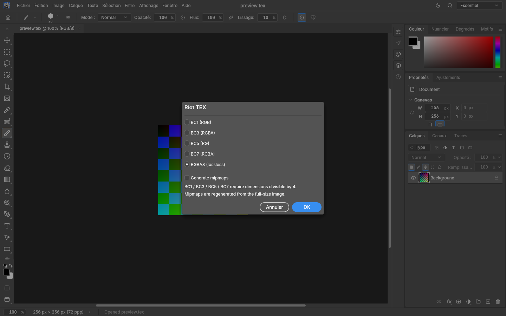

# Riot TEX (.tex)

The original Photoshop plugin is not loaded. The Riot TEX container is implemented
in the normal Rust codec pipeline using the public RitoTex format specification.

## Use

Open or drag a `.tex` file into PhotoCraft. Choose File > Save As, select Riot TEX
(or type a `.tex` filename), then choose BC1, BC3, BC5, BC7 or lossless BGRA8 and
whether to generate mipmaps. Save a Copy supports the same choices.

The source compression and mip flag are remembered, including in `.pcraft` projects.
New files default to lossless BGRA8 with mipmaps. The original source mip levels are
not editable layers: saves regenerate the full chain from the edited full-size image,
using an independent box average per channel, smallest level first.
BC formats require dimensions divisible by four. The smaller mip tails are edge-padded.
BGRA8 supports arbitrary nonzero dimensions up to the container's 65535 limit.

TEX alpha opens as an `Alpha 1` channel, with opaque RGB, to retain mask data and
RGB values underneath zero alpha. Saving TEX writes that channel back. With no alpha
channel, layer transparency supplies alpha. More than one non-spot alpha channel is
rejected instead of guessing. BC1 export rejects nonopaque alpha; use BC3 or BC7
for transparency. BC5 stores R/G only, decodes blue as zero and alpha as opaque.
Colour documents with layers flatten into TEX; keep `.pcraft` or PSD for editable layers.
Block compression is lossy; it need not reproduce Photoshop/ISPC's exact compressed bytes.
BGRA8 preserves 8-bit RGBA pixels without block compression. 16/32-bit documents are
quantized to 8 bits with the normal export fidelity warnings.

Supported: native TEX import/export, source encoding defaults, alpha, full mip chains,
open/save dialogs, drag/drop, CLI, automation, recorded Save As choices.
Outside this TEX integration: cube maps, mipmaps from layers, Photoshop compression preview,
normal-map flip/normalize tools, custom dithering, update checker, ETC encodings.

## Automation

`photocraft-cli convert input.png output.tex --tex-format bc7 --tex-mipmaps true`

`--tex-format`: bc1, bc3, bc5, bc7, bgra8. `--tex-mipmaps`: true or false.
Engine save parameters: `texCompression` = 10, 12, 14, 13, 20 respectively;
`texMipmaps` = boolean. Invalid values fail without writing.

## Implementation

The public format description is available in [RitoTex-Photoshop](https://github.com/RitoShark/RitoTex-Photoshop/tree/de4e252a36561ffd77a58f9cd1b66ab9f558423e).
CPU block compression uses the MIT-licensed `block_compression` crate. No Photoshop plugin binary is needed.
